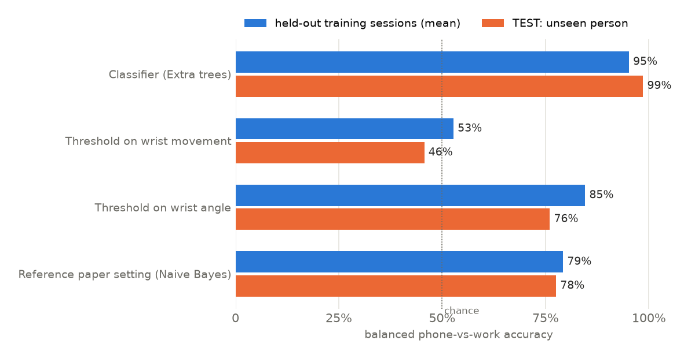
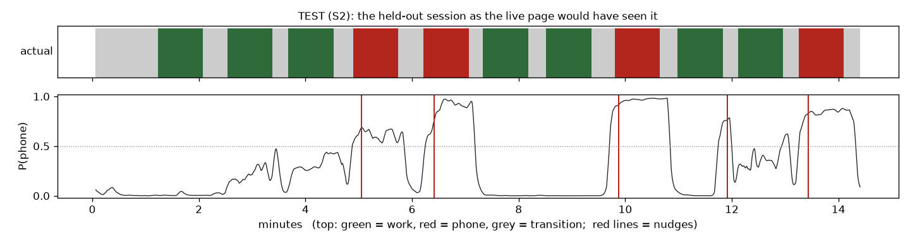
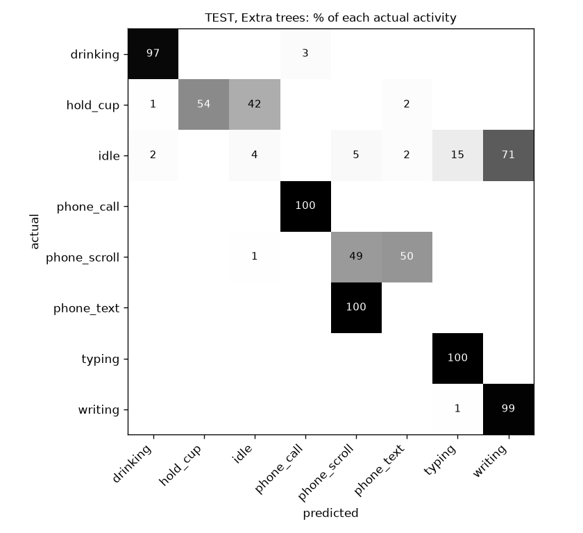

# Focus Police model report, 22 Nov 2026 18:21

Generated by `Model/train.py` (version 2). Everything below is measured on the recordings in `Data Collection/sessions/`. Why version 2 looks the way it does: `Model/lab/FINDINGS.md`.

**Read this first:**

- Some sessions have no recorded calibration step; their calibration pose was taken from the first 5 s of typing, which is the same pose (hands on the keyboard). See the table below.
- Training covers 2 participant(s) (P1, Suleiman). Accuracy on a new person is the open question; record more people to measure it.

## 1. What was chosen

- **Model:** Extra trees
- **Features:** motion + wrist angle + context, calibrated; 4 s window (220 numbers)
- **Live smoothing:** average of the last 9 predictions (held-out false nudges for 1 / 5 / 9: 1 / 1 / 0)
- **Selection rule:** best balanced on/off accuracy, then fewest false alarms, then activity macro-F1, all from holding out one whole training session at a time.
- Held-out score of the choice: balanced 95.4% (phone caught 94.2%, false alarms 3.4%); per held-out session [0.963, 0.926, 0.972].
- 12 candidates compared in 61 s.

Sessions:

| folder | session | participant | role | labelled min | activities | calibration |
|---|---|---|---|---|---|---|
| LIVE_20261112-233400 | S1 | P1 | train | 8.9 | 8 | first 5 s of typing (no calibration step) |
| LIVE_20261117-112826 | PILOT | P2 | ignored | 1.3 | 1 | none (no calibration step and no typing) |
| LIVE_20261117-120325 | PILOT | P1 | ignored | 0.5 | 2 | first 5 s of typing (no calibration step) |
| LIVE_20261117-120625 | S2 | P2 | test | 9.9 | 8 | first 5 s of typing (no calibration step) |
| LIVE_20261122-063931 | PILOT | P1 | ignored | 0.5 | 2 | first 5 s of typing (no calibration step) |
| LIVE_20261122-071736 | S1 | Suleiman | train | 13.7 | 8 | first 5 s of typing (no calibration step) |
| LIVE_20261122-073853 | S2 | Suleiman | train | 14.7 | 8 | first 5 s of typing (no calibration step) |

## 2. The final score (TEST, never used for any choice)

TEST: S2 (P2, LIVE_20261117-120625). Scored on the continuous recording, every 0.5 s, as the live page runs.

| | Balanced on/off | Phone caught | False alarms | False nudges | Phone activities nudged | Median nudge delay |
|---|---|---|---|---|---|---|
| **Chosen model**, smoothed over 9 predictions as on the live page | **98.6%** | 99.0% | 1.8% | 0 (0.0/h) | 100.0% | 10 s |
| Chosen model, each prediction on its own | **98.2%** | 100.0% | 3.7% | 0 (0.0/h) | 100.0% | 6 s |
| Reference-paper setting: raw accelerometer, simple features, Naive Bayes | **77.6%** | 57.6% | 2.5% | 0 (0.0/h) | 75.0% | 13 s |
| Threshold on wrist movement: phone when `userAccelerationMag_std` < 0.0232 | **45.7%** | 46.6% | 55.2% | 7 (71.0/h) | 75.0% | 41 s |
| Threshold on wrist angle (calibrated): phone when `win_pitch_mean` < -54 | **76.0%** | 57.1% | 5.1% | 0 (0.0/h) | 75.0% | 6 s |

The threshold rows are the proposal's baseline: one number per window and one cut-off, fitted on the training sessions (`Model/baseline.py`).

Activity names (not needed for the nudge): accuracy 55.5%, macro-F1 0.577 over 8 activities.

**What each part adds** (same model and window, retrained without the part, scored on TEST):

| | Balanced on/off | Phone caught | False alarms | False nudges | Phone activities nudged | Median nudge delay |
|---|---|---|---|---|---|---|
| motion only (version 1 features) | **97.7%** | 97.0% | 1.5% | 0 (0.0/h) | 100.0% | 10 s |
| + wrist angle + context, not calibrated | **95.3%** | 90.6% | 0.0% | 0 (0.0/h) | 100.0% | 12 s |
| + calibration (full) | **98.6%** | 99.0% | 1.8% | 0 (0.0/h) | 100.0% | 10 s |

Per activity on TEST:

| activity | flagged as phone | activity recall | windows |
|---|---|---|---|
| drinking | 0 | 0.97 | 101 |
| hold_cup | 0.015 | 0.542 | 203 |
| idle | 0.049 | 0.039 | 203 |
| phone_call | 0.961 | 1 | 102 |
| phone_scroll | 1 | 0.488 | 203 |
| phone_text | 1 | 0 | 101 |
| typing | 0 | 1 | 102 |
| writing | 0 | 0.99 | 101 |

**The one challenge: look-alikes** (proposal). Share of each activity's windows flagged as phone on TEST. Drinking, holding a cup and the calculator are work and should stay near 0; the phone rows should be near 1.

| model | drinking | hold_cup | phone_call | phone_text | phone_scroll |
|---|---|---|---|---|---|
| Chosen model (Extra trees) | 0 | 0.015 | 0.961 | 1 | 1 |
| Threshold on wrist movement | 0 | 0.69 | 0.725 | 0.386 | 0.374 |
| Threshold on wrist angle (calibrated) | 0 | 0.084 | 0 | 1 | 0.645 |
| Reference-paper setting | 0 | 0.005 | 0.951 | 0.851 | 0.251 |

*Balanced on/off* is the mean of *phone caught* (phone windows flagged) and work time left alone (1 − *false alarms*). A *nudge* fires after 10 s flagged as phone in a row; one during work is false. The delay counts from the start of the labelled phone activity, which begins 3 s after the runner click.

## 2b. Classifier vs the baselines, holding out one training session at a time

Held-out sessions, in order: S1 (P1), S1 (Suleiman), S2 (Suleiman). A session from a person missing from the other sessions is a cross-person test.

| | Balanced on/off | Phone caught | False alarms | False nudges | Phone activities nudged | Balanced per held-out session |
|---|---|---|---|---|---|---|
| **Chosen model** (Extra trees, smoothed over 9) | **95.2%** | 93.0% | 2.6% | 0 | 100.0% | [0.97, 0.927, 0.959] |
| Threshold on wrist movement | **52.7%** | 82.5% | 77.0% | 27 | 100.0% | [0.447, 0.56, 0.575] |
| Threshold on wrist angle (calibrated) | **84.6%** | 71.0% | 1.8% | 1 | 71.1% | [0.826, 0.88, 0.832] |
| Reference-paper setting (raw accelerometer, Naive Bayes) | **79.2%** | 70.6% | 12.2% | 5 | 77.8% | [0.573, 0.893, 0.911] |

## 5. All candidates

Held out one whole training session at a time. TEST was not involved.

| window_s | features | model | cv_balanced | cv_false_alarm | cv_phone_caught | cv_false_nudges | cv_macro_f1 |
|---|---|---|---|---|---|---|---|
| 4 | motion + wrist angle + context, calibrated | Extra trees | 0.954 | 0.034 | 0.942 | 1 | 0.515 |
| 4 | motion + wrist angle + context, calibrated | Random forest | 0.948 | 0.039 | 0.936 | 2 | 0.514 |
| 2 | motion + wrist angle + context, calibrated | Extra trees | 0.947 | 0.042 | 0.937 | 1 | 0.492 |
| 2 | motion + wrist angle + context, calibrated | Random forest | 0.938 | 0.05 | 0.927 | 2 | 0.468 |
| 2 | motion + wrist angle + context, calibrated | Logistic regression | 0.904 | 0.098 | 0.905 | 1 | 0.532 |
| 4 | motion + wrist angle + context, calibrated | Logistic regression | 0.904 | 0.099 | 0.908 | 0 | 0.546 |
| 4 | motion only | Extra trees | 0.876 | 0.057 | 0.81 | 0 | 0.519 |
| 4 | motion only | Random forest | 0.867 | 0.039 | 0.773 | 0 | 0.496 |
| 2 | motion only | Extra trees | 0.858 | 0.077 | 0.793 | 1 | 0.509 |
| 2 | motion only | Random forest | 0.857 | 0.051 | 0.765 | 0 | 0.475 |
| 2 | motion only | Logistic regression | 0.813 | 0.085 | 0.71 | 1 | 0.465 |
| 4 | motion only | Logistic regression | 0.81 | 0.064 | 0.685 | 1 | 0.487 |

Features the model leans on most: `ctx10_pitch_mean`, `gravityY_max`, `ctx10_gy_mean`, `gravityY_min`, `gravityY_mean`, `win_pitch_mean`, `win_pitch_max`, `ctx30_pitch_min`, `ctx30_roll_c_std`, `ctx10_gx_mean`, `ctx10_face_mean`, `gravityX_mean`.

## 6. How to read this

- **Balanced on/off accuracy** averages phone caught and work left alone, so a model that never flags anything can't look good. It decides the choice.
- **False alarms** are work moments flagged as phone; ten seconds of them in a row make a false nudge, which is what makes people switch a focus tool off.
- **Held-out sessions** are the honest test: the model is judged on a sitting it never saw.
- Idle (reading, hands resting) counts as on task here. The reference paper counted sitting idle as distracted.

