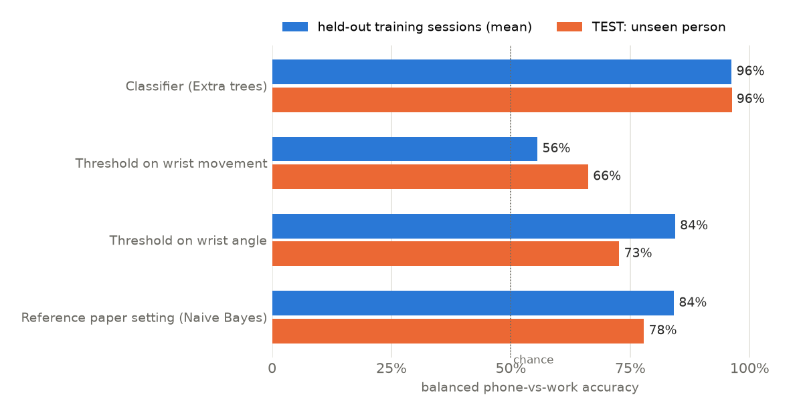
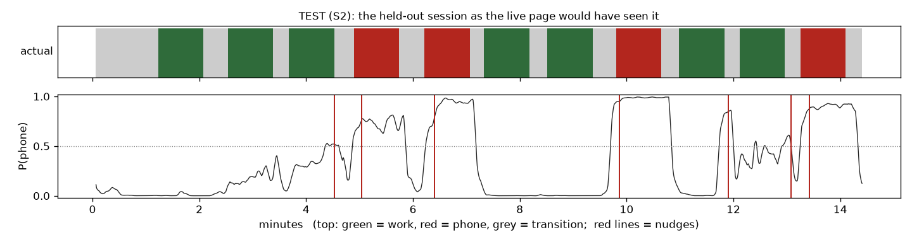
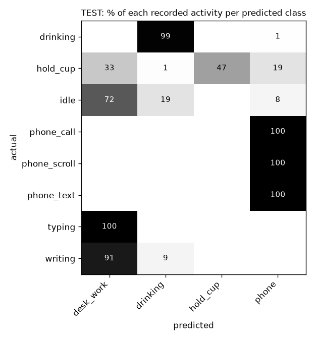
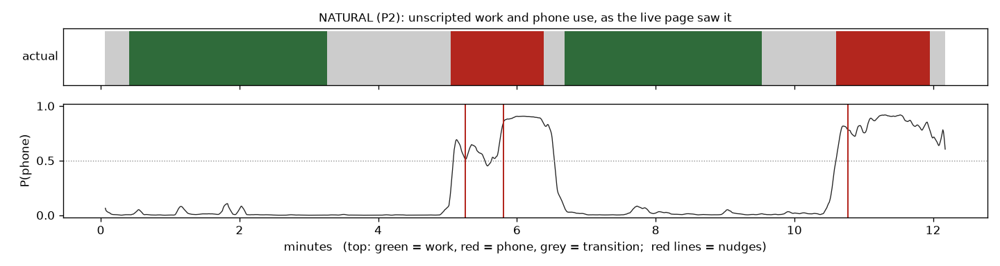

# Focus Police model report, 22 Nov 2026 21:10

Generated by `Model/train.py` (version 2). Everything below is measured on the recordings in `Data Collection/sessions/`. Why version 2 looks the way it does: `Model/lab/FINDINGS.md`.

**Read this first:**

- Some sessions have no recorded calibration step; their calibration pose was taken from the first 5 s of typing, which is the same pose (hands on the keyboard). See the table below.

## 1. What was chosen

- **Model:** Extra trees
- **Features:** motion + wrist angle + context, calibrated; 4 s window (220 numbers)
- **Live smoothing:** average of the last 9 predictions (held-out false nudges for 1 / 5 / 9: 5 / 5 / 3)
- **Selection rule:** best balanced on/off accuracy, then fewest false alarms, then activity macro-F1, all from holding out one whole training session at a time.
- Held-out score of the choice: balanced 97.0% (phone caught 96.9%, false alarms 3.0%); per held-out session [0.974, 0.944, 0.967, 0.993].
- 12 candidates compared in 153 s.

Sessions:

| folder | session | participant | role | labelled min | activities | calibration |
|---|---|---|---|---|---|---|
| LIVE_20261112-233400 | S1 | P1 | train | 8.9 | 8 | first 5 s of typing (no calibration step) |
| LIVE_20261117-112826 | PILOT | P2 | ignored | 1.3 | 1 | none (no calibration step and no typing) |
| LIVE_20261117-120325 | PILOT | P1 | ignored | 0.5 | 2 | first 5 s of typing (no calibration step) |
| LIVE_20261117-120625 | S2 | P2 | test | 9.9 | 8 | first 5 s of typing (no calibration step) |
| LIVE_20261122-063931 | PILOT | P1 | ignored | 0.5 | 2 | first 5 s of typing (no calibration step) |
| LIVE_20261122-071736 | S1 | Suleiman | train | 13.7 | 8 | first 5 s of typing (no calibration step) |
| LIVE_20261122-073853 | S2 | Suleiman | train | 14.7 | 8 | first 5 s of typing (no calibration step) |
| LIVE_20261122-163642 | S3 | Sleiman | train | 14.3 | 8 | calibration step |
| LIVE_20261122-204024 | NATURAL | P2 | natural | 8.6 | 2 | calibration step |

## 2. The final score (TEST, never used for any choice)

TEST: S2 (P2, LIVE_20261117-120625). Scored on the continuous recording, every 0.5 s, as the live page runs.

| | Balanced on/off | Phone caught | False alarms | False nudges (10 s) | False watch buzzes (2 min) | Phone activities nudged | Median nudge delay |
|---|---|---|---|---|---|---|---|
| **Chosen model**, smoothed over 9 predictions as on the live page | **96.3%** | 99.3% | 6.8% | 2 (11.0/h) | 0 (0.0/h) | 100.0% | 9 s |
| Chosen model, each prediction on its own | **95.7%** | 100.0% | 8.6% | 1 (5.5/h) | 0 (0.0/h) | 100.0% | 6 s |
| Chosen model, watch on the other wrist (TEST mirrored, simulated) | **97.1%** | 99.3% | 5.1% | 1 (5.5/h) | 0 (0.0/h) | 100.0% | 9 s |
| Reference-paper setting: raw accelerometer, simple features, Naive Bayes | **77.9%** | 58.1% | 2.4% | 1 (5.5/h) | 0 (0.0/h) | 75.0% | 13 s |
| Threshold on wrist movement: phone when `userAccelerationMag_std` > 0.00584 | **66.2%** | 91.4% | 59.0% | 7 (38.4/h) | 0 (0.0/h) | 100.0% | 0 s |
| Threshold on wrist angle (calibrated): phone when `win_pitch_mean` < -55.2 | **72.7%** | 49.8% | 4.4% | 1 (5.5/h) | 0 (0.0/h) | 50.0% | 3 s |

The threshold rows are the proposal's baseline: one number per window and one cut-off, fitted on the training sessions (`Model/baseline.py`).

Classes (desk_work, drinking, hold_cup, phone): accuracy 84.4%, macro-F1 0.801. The model is trained on every recorded activity; typing, writing, reading and the calculator are reported as one class, desk work, and the phone activities as phone, because one wrist cannot tell them apart and they need the same response (features.GROUPS). The per-activity table below scores each recorded activity against its class.

**What each part adds** (same model and window, retrained without the part, scored on TEST):

| | Balanced on/off | Phone caught | False alarms | False nudges (10 s) | False watch buzzes (2 min) | Phone activities nudged | Median nudge delay |
|---|---|---|---|---|---|---|---|
| motion only (version 1 features) | **98.5%** | 98.8% | 1.7% | 0 (0.0/h) | 0 (0.0/h) | 100.0% | 10 s |
| + wrist angle + context, not calibrated | **99.3%** | 98.5% | 0.0% | 0 (0.0/h) | 0 (0.0/h) | 100.0% | 10 s |
| + calibration (full) | **96.3%** | 99.3% | 6.8% | 2 (11.0/h) | 0 (0.0/h) | 100.0% | 9 s |

Per activity on TEST:

| activity | reported class | flagged as phone | recognised as its class | windows |
|---|---|---|---|---|
| drinking | drinking | 0 | 0.99 | 101 |
| hold_cup | hold_cup | 0.177 | 0.468 | 203 |
| idle | desk_work | 0.059 | 0.724 | 203 |
| phone_call | phone | 0.971 | 1 | 102 |
| phone_scroll | phone | 1 | 1 | 203 |
| phone_text | phone | 1 | 1 | 101 |
| typing | desk_work | 0 | 1 | 102 |
| writing | desk_work | 0 | 0.911 | 101 |

**The one challenge: look-alikes** (proposal). Share of each activity's windows flagged as phone on TEST. Drinking, holding a cup and the calculator are work and should stay near 0; the phone rows should be near 1.

| model | drinking | hold_cup | phone_call | phone_text | phone_scroll |
|---|---|---|---|---|---|
| Chosen model (Extra trees) | 0 | 0.177 | 0.971 | 1 | 1 |
| Threshold on wrist movement | 1 | 0.488 | 0.657 | 1 | 1 |
| Threshold on wrist angle (calibrated) | 0 | 0.059 | 0 | 1 | 0.498 |
| Reference-paper setting | 0 | 0 | 0.951 | 0.752 | 0.31 |

*Balanced on/off* is the mean of *phone caught* (phone windows flagged) and work time left alone (1 − *false alarms*). A *nudge* fires after 10 s flagged as phone in a row (the watch buzzes after 120 s); it is false when no labelled phone use lies within 15 s of it, so nudges while switching between activities count as false. Per hour means per hour of time not on the phone. The delay counts from the start of the labelled phone activity, which begins 3 s after the runner click.

## 3. NATURAL (unscripted work and phone use)

Closest to real use. The phone may have been in either hand.
Sessions: NATURAL (P2, LIVE_20261122-204024).

Phone caught 95.0%, false alarms 0.0%, false nudges 0 (0.0/h), false watch buzzes 0, phone activities nudged 100.0%, median nudge delay 11 s, over 5.7 min not on the phone.

## 2b. Classifier vs the baselines, holding out one training session at a time

Held-out sessions, in order: S1 (P1), S1 (Suleiman), S2 (Suleiman), S3 (Sleiman). A session from a person missing from the other sessions is a cross-person test.

| | Balanced on/off | Phone caught | False alarms | False nudges (10 s) | False watch buzzes (2 min) | Phone activities nudged | Balanced per held-out session |
|---|---|---|---|---|---|---|---|
| **Chosen model** (Extra trees, smoothed over 9) | **96.2%** | 95.3% | 2.9% | 3 | 1 | 100.0% | [0.968, 0.936, 0.959, 0.986] |
| Threshold on wrist movement | **55.6%** | 92.0% | 80.8% | 49 | 3 | 100.0% | [0.454, 0.612, 0.6, 0.558] |
| Threshold on wrist angle (calibrated) | **84.4%** | 70.2% | 1.4% | 4 | 1 | 70.0% | [0.831, 0.88, 0.832, 0.833] |
| Reference-paper setting (raw accelerometer, Naive Bayes) | **84.1%** | 77.7% | 9.4% | 9 | 0 | 83.3% | [0.6, 0.911, 0.912, 0.944] |

## 5. All candidates

Held out one whole training session at a time. TEST was not involved.

| window_s | features | model | cv_balanced | cv_false_alarm | cv_phone_caught | cv_false_nudges | cv_macro_f1 |
|---|---|---|---|---|---|---|---|
| 4 | motion + wrist angle + context, calibrated | Extra trees | 0.97 | 0.03 | 0.969 | 5 | 0.547 |
| 4 | motion + wrist angle + context, calibrated | Random forest | 0.963 | 0.034 | 0.961 | 5 | 0.56 |
| 2 | motion + wrist angle + context, calibrated | Random forest | 0.957 | 0.041 | 0.956 | 7 | 0.512 |
| 2 | motion + wrist angle + context, calibrated | Extra trees | 0.957 | 0.042 | 0.956 | 5 | 0.528 |
| 2 | motion + wrist angle + context, calibrated | Logistic regression | 0.927 | 0.072 | 0.925 | 6 | 0.588 |
| 4 | motion only | Extra trees | 0.909 | 0.045 | 0.863 | 5 | 0.568 |
| 4 | motion + wrist angle + context, calibrated | Logistic regression | 0.908 | 0.068 | 0.885 | 7 | 0.588 |
| 2 | motion only | Extra trees | 0.897 | 0.061 | 0.855 | 5 | 0.551 |
| 4 | motion only | Random forest | 0.896 | 0.032 | 0.825 | 3 | 0.559 |
| 2 | motion only | Random forest | 0.89 | 0.048 | 0.828 | 4 | 0.548 |
| 4 | motion only | Logistic regression | 0.84 | 0.062 | 0.742 | 6 | 0.522 |
| 2 | motion only | Logistic regression | 0.831 | 0.078 | 0.741 | 6 | 0.49 |

Features the model leans on most: `ctx10_gy_mean`, `ctx10_pitch_mean`, `win_pitch_mean`, `ctx10_face_mean`, `gravityY_mean`, `gravityY_min`, `win_face_min`, `gravityY_max`, `win_pitch_min`, `win_pitch_max`, `gravityZ_max`, `ctx10_pitch_min`.

## 6. How to read this

- **Balanced on/off accuracy** averages phone caught and work left alone, so a model that never flags anything can't look good. It decides the choice.
- **False alarms** are work moments flagged as phone; ten seconds of them in a row make a false nudge, which is what makes people switch a focus tool off.
- **Held-out sessions** are the honest test: the model is judged on a sitting it never saw.
- Idle (reading, hands resting) counts as on task here. The reference paper counted sitting idle as distracted.

