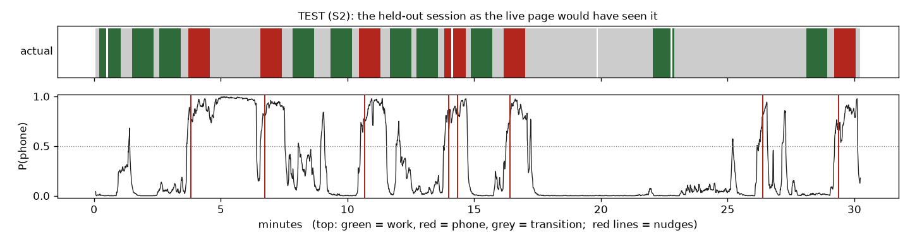
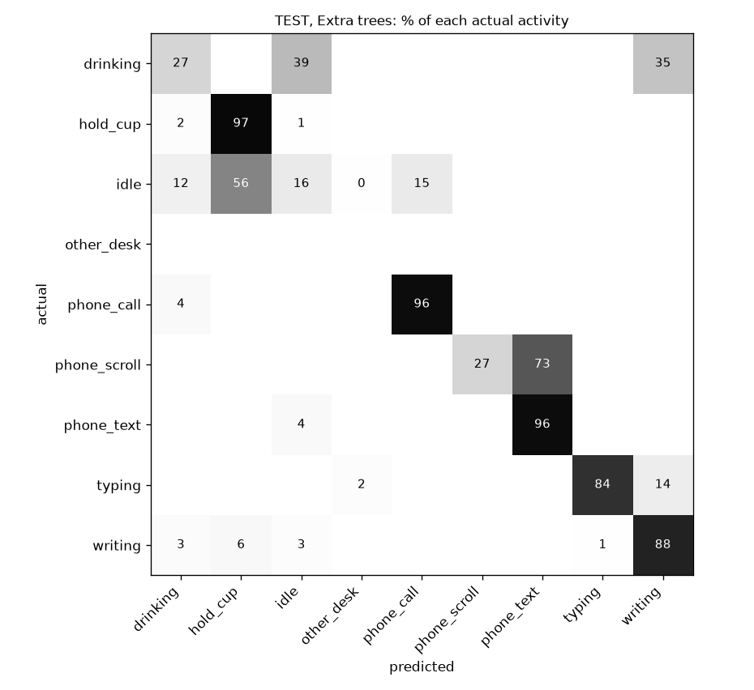

# Focus Police model report, 22 Nov 2026 09:39

Generated by `Model/train.py` (version 2). Everything below is measured on the recordings in `Data Collection/sessions/`. Why version 2 looks the way it does: `Model/lab/FINDINGS.md`.

**Read this first:**

- No TEST session was recorded, so the last training session (S2, LIVE_20261122-073853) was set aside as the test set.
- Some sessions have no recorded calibration step; their calibration pose was taken from the first 5 s of typing, which is the same pose (hands on the keyboard). See the table below.
- Training covers 2 participant(s) (P1, Suleiman). Accuracy on a new person is the open question; record more people to measure it.

## 1. What was chosen

- **Model:** Extra trees
- **Features:** motion + wrist angle + context, calibrated; 4 s window (220 numbers)
- **Live smoothing:** average of the last 1 predictions (held-out false nudges for 1 / 5 / 9: 3 / 3 / 3)
- **Selection rule:** best balanced on/off accuracy, then fewest false alarms, then activity macro-F1, all from holding out one whole training session at a time.
- Held-out score of the choice: balanced 88.6% (phone caught 94.0%, false alarms 16.8%); per held-out session [0.874, 0.899].
- 12 candidates compared in 100 s.

Sessions:

| folder | session | participant | role | labelled min | activities | calibration |
|---|---|---|---|---|---|---|
| LIVE_20261112-233400 | S1 | P1 | train | 8.9 | 8 | first 5 s of typing (no calibration step) |
| LIVE_20261122-063931 | PILOT | P1 | ignored | 0.5 | 2 | first 5 s of typing (no calibration step) |
| LIVE_20261122-071736 | S1 | Suleiman | train | 13.7 | 8 | first 5 s of typing (no calibration step) |
| LIVE_20261122-073853 | S2 | Suleiman | train | 14.7 | 8 | first 5 s of typing (no calibration step) |

## 2. The final score (TEST, never used for any choice)

TEST: S2 (Suleiman, LIVE_20261122-073853). Scored on the continuous recording, every 0.5 s, as the live page runs.

| | Balanced on/off | Phone caught | False alarms | False nudges | Phone activities nudged | Median nudge delay |
|---|---|---|---|---|---|---|
| **Chosen model**, smoothed over 1 predictions as on the live page | **97.1%** | 96.5% | 2.2% | 0 (0.0/h) | 100.0% | 11 s |
| Chosen model, each prediction on its own | **97.1%** | 96.5% | 2.2% | 0 (0.0/h) | 100.0% | 11 s |
| Reference-paper setting: raw accelerometer, simple features, Naive Bayes | **91.1%** | 90.5% | 8.2% | 0 (0.0/h) | 100.0% | 12 s |

Activity names (not needed for the nudge): accuracy 66.2%, macro-F1 0.556 over 9 activities.

**What each part adds** (same model and window, retrained without the part, scored on TEST):

| | Balanced on/off | Phone caught | False alarms | False nudges | Phone activities nudged | Median nudge delay |
|---|---|---|---|---|---|---|
| motion only (version 1 features) | **94.5%** | 94.2% | 5.1% | 0 (0.0/h) | 100.0% | 11 s |
| + wrist angle + context, not calibrated | **97.3%** | 96.7% | 2.0% | 0 (0.0/h) | 100.0% | 10 s |
| + calibration (full) | **97.1%** | 96.5% | 2.2% | 0 (0.0/h) | 100.0% | 11 s |

Per activity on TEST:

| activity | flagged as phone | activity recall | windows |
|---|---|---|---|
| drinking | 0 | 0.267 | 202 |
| hold_cup | 0 | 0.97 | 203 |
| idle | 0.108 | 0.158 | 203 |
| other_desk |  |  | 0 |
| phone_call | 0.95 | 0.955 | 202 |
| phone_scroll | 0.995 | 0.267 | 195 |
| phone_text | 0.951 | 0.956 | 203 |
| typing | 0 | 0.841 | 195 |
| writing | 0 | 0.882 | 195 |

*Balanced on/off* is the mean of *phone caught* (phone windows flagged) and work time left alone (1 − *false alarms*). A *nudge* fires after 10 s flagged as phone in a row; one during work is false. The delay counts from the start of the labelled phone activity, which begins 3 s after the runner click.

## 5. All candidates

Held out one whole training session at a time. TEST was not involved.

| window_s | features | model | cv_balanced | cv_false_alarm | cv_phone_caught | cv_false_nudges | cv_macro_f1 |
|---|---|---|---|---|---|---|---|
| 4 | motion + wrist angle + context, calibrated | Extra trees | 0.886 | 0.168 | 0.94 | 3 | 0.348 |
| 2 | motion + wrist angle + context, calibrated | Random forest | 0.877 | 0.17 | 0.924 | 3 | 0.406 |
| 2 | motion + wrist angle + context, calibrated | Extra trees | 0.874 | 0.182 | 0.929 | 3 | 0.356 |
| 4 | motion + wrist angle + context, calibrated | Random forest | 0.872 | 0.164 | 0.909 | 2 | 0.387 |
| 2 | motion + wrist angle + context, calibrated | Logistic regression | 0.858 | 0.184 | 0.899 | 4 | 0.312 |
| 4 | motion + wrist angle + context, calibrated | Logistic regression | 0.845 | 0.19 | 0.88 | 2 | 0.318 |
| 4 | motion only | Random forest | 0.71 | 0.196 | 0.615 | 5 | 0.184 |
| 2 | motion only | Random forest | 0.704 | 0.208 | 0.616 | 4 | 0.196 |
| 4 | motion only | Extra trees | 0.703 | 0.242 | 0.648 | 6 | 0.178 |
| 2 | motion only | Extra trees | 0.697 | 0.246 | 0.64 | 7 | 0.186 |
| 4 | motion only | Logistic regression | 0.662 | 0.253 | 0.577 | 2 | 0.241 |
| 2 | motion only | Logistic regression | 0.618 | 0.271 | 0.506 | 3 | 0.223 |

Features the model leans on most: `ctx10_pitch_mean`, `ctx10_gy_mean`, `win_pitch_mean`, `gravityY_max`, `gravityX_mean`, `gravityY_mean`, `ctx10_gx_mean`, `ctx30_roll_c_std`, `gravityX_max`, `win_face_min`, `ctx10_pitch_max`, `gravityX_min`.

## 6. How to read this

- **Balanced on/off accuracy** averages phone caught and work left alone, so a model that never flags anything can't look good. It decides the choice.
- **False alarms** are work moments flagged as phone; ten seconds of them in a row make a false nudge, which is what makes people switch a focus tool off.
- **Held-out sessions** are the honest test: the model is judged on a sitting it never saw.
- Idle (reading, hands resting) counts as on task here. The reference paper counted sitting idle as distracted.

