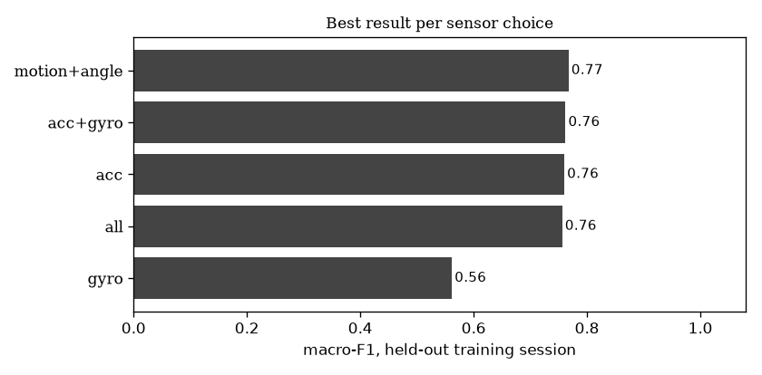
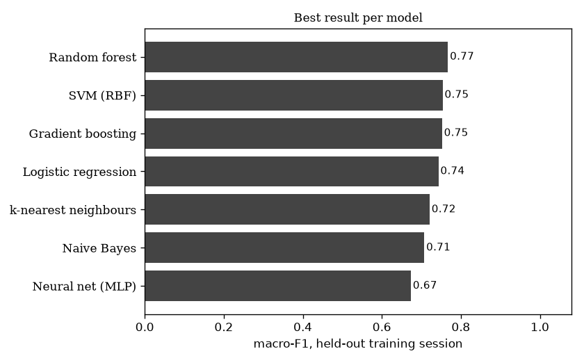

# Focus Police model report, 12 Nov 2026 23:51

Generated by `Model/train.py`. Everything below is measured on the recordings in `Data Collection/sessions/`.

**Read this first:**

- Only ONE training session, so models were compared by holding out a quarter of every block at a time, inside that one session. These scores are OPTIMISTIC: the same sitting, the same watch placement, and the held-out quarter sits right next to the training part. They show whether the activities are separable at all, not how the model does on a new day.
- No test session: the final score below is the cross-validation score, not a held-out test.

## 1. What was chosen

- **Model:** Random forest
- **Sensors:** motion+angle (userAccelerationX, userAccelerationY, userAccelerationZ, gravityX, gravityY, gravityZ)
- **Window:** 2 s, half-overlapping; **features:** time+frequency (110 numbers per window)
- **Live smoothing:** average of the last 1 windows (on/off accuracy when holding out a quarter of every block at a time, within the single training session: 1 → 98.3%, 3 → 95.6%, 5 → 92.0%)
- Chosen by holding out a quarter of every block at a time, within the single training session: macro-F1 0.767, accuracy 76.5%, on/off 98.3%. Score on each held-out part: [0.705, 0.837, 0.85, 0.677].
- 210 combinations compared; 523 training windows; 47 s to run.

Sessions used:

| folder | session | role | labelled min | activities | shortest activity (s) |
|---|---|---|---|---|---|
| LIVE_20261112-233400 | S1 | train | 8.9 | 8 | 47 |

## 2. The final score

No test session. Best cross-validation result: macro-F1 0.767, accuracy 76.5%, on/off 98.3%.

## 5. What works best (the comparison)

All numbers here come from holding out a quarter of every block at a time, within the single training session. TEST was not involved.

**By sensors** (best combination for each):

| window_s | sensors | features | model | cv_macro_f1 | cv_accuracy | cv_onoff_accuracy |
|---|---|---|---|---|---|---|
| 2 | motion+angle | time+frequency | Random forest | 0.767 | 0.765 | 0.983 |
| 2 | acc+gyro | time | Random forest | 0.762 | 0.762 | 0.983 |
| 2 | acc | time | Random forest | 0.76 | 0.76 | 0.983 |
| 2 | all | time+frequency | Random forest | 0.756 | 0.759 | 0.985 |
| 4 | gyro | time+frequency | Logistic regression | 0.562 | 0.557 | 0.823 |

**By model:**

| window_s | sensors | features | model | cv_macro_f1 | cv_accuracy | cv_onoff_accuracy |
|---|---|---|---|---|---|---|
| 2 | motion+angle | time+frequency | Random forest | 0.767 | 0.765 | 0.983 |
| 2 | acc | time | SVM (RBF) | 0.754 | 0.75 | 0.985 |
| 1 | acc+gyro | time | Gradient boosting | 0.752 | 0.749 | 0.975 |
| 4 | acc+gyro | time | Logistic regression | 0.743 | 0.746 | 0.981 |
| 1 | acc | time | k-nearest neighbours | 0.721 | 0.722 | 0.973 |
| 4 | acc | time | Naive Bayes | 0.708 | 0.711 | 0.968 |
| 1 | motion+angle | time | Neural net (MLP) | 0.674 | 0.686 | 0.959 |

**By window length:**

| window_s | sensors | features | model | cv_macro_f1 | cv_accuracy | cv_onoff_accuracy |
|---|---|---|---|---|---|---|
| 2 | motion+angle | time+frequency | Random forest | 0.767 | 0.765 | 0.983 |
| 4 | acc | time+frequency | Random forest | 0.757 | 0.754 | 0.976 |
| 1 | acc+gyro | time | Gradient boosting | 0.752 | 0.749 | 0.975 |

**By feature set:**

| window_s | sensors | features | model | cv_macro_f1 | cv_accuracy | cv_onoff_accuracy |
|---|---|---|---|---|---|---|
| 2 | motion+angle | time+frequency | Random forest | 0.767 | 0.765 | 0.983 |
| 2 | acc+gyro | time | Random forest | 0.762 | 0.762 | 0.983 |

**Top 15 combinations overall:**

| window_s | sensors | features | model | cv_macro_f1 | cv_accuracy | cv_onoff_accuracy |
|---|---|---|---|---|---|---|
| 2 | motion+angle | time+frequency | Random forest | 0.767 | 0.765 | 0.983 |
| 2 | acc+gyro | time | Random forest | 0.762 | 0.762 | 0.983 |
| 2 | acc | time | Random forest | 0.76 | 0.76 | 0.983 |
| 4 | acc | time+frequency | Random forest | 0.757 | 0.754 | 0.976 |
| 2 | acc+gyro | time+frequency | Random forest | 0.756 | 0.756 | 0.985 |
| 2 | acc | time+frequency | Random forest | 0.756 | 0.754 | 0.985 |
| 2 | all | time+frequency | Random forest | 0.756 | 0.759 | 0.985 |
| 2 | acc | time | SVM (RBF) | 0.754 | 0.75 | 0.985 |
| 4 | acc+gyro | time+frequency | Random forest | 0.753 | 0.75 | 0.969 |
| 1 | acc+gyro | time | Gradient boosting | 0.752 | 0.749 | 0.975 |
| 2 | all | time | Gradient boosting | 0.752 | 0.75 | 0.954 |
| 2 | all | time | Random forest | 0.752 | 0.752 | 0.985 |
| 1 | acc+gyro | time+frequency | Gradient boosting | 0.75 | 0.75 | 0.977 |
| 4 | acc | time | Random forest | 0.746 | 0.746 | 0.976 |
| 4 | motion+angle | time+frequency | Random forest | 0.746 | 0.746 | 0.965 |

Features the model leans on most: `gravityY_max` (0.060), `gravityY_mean` (0.058), `gravityY_min` (0.055), `gravityX_min` (0.052), `gravityX_mean` (0.051), `gravityX_max` (0.049), `gravityZ_max` (0.046), `gravityZ_mean` (0.040), `gravityZ_min` (0.039), `userAccelerationX_mean` (0.029), `userAccelerationY_mean` (0.022), `gravityY_jerk` (0.019).

## 6. How to read this

- **Macro-F1** averages the score of every activity equally, so a model can't look good by only getting the easy ones right.
- **On/off-task accuracy** is what the nudge depends on: typing mistaken for writing costs nothing there, phone mistaken for typing does.
- **Held-out session** scores are lower than a random split would give, and more honest: the model is judged on a sitting it never saw.
- All of this is one person. Accuracy on someone else will be lower until they record their own sessions.
- Idle (reading, hands resting) counts as on task here. The reference paper counted sitting idle as distracted.

Every combination is in `all_combinations.csv` (210 rows).
