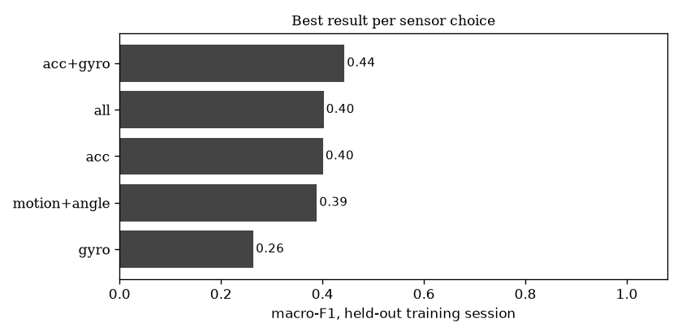
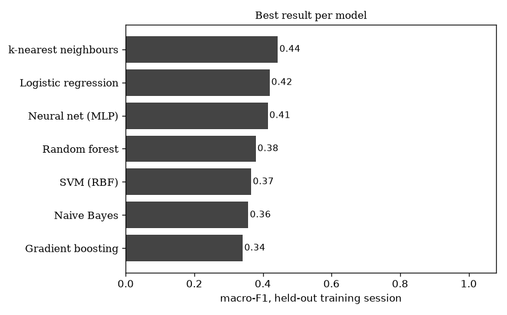

# Focus Police model report, 17 Nov 2026 12:25

Generated by `Model/train.py`. Everything below is measured on the recordings in `Data Collection/sessions/`.

**Read this first:**

- No test session: the final score below is the cross-validation score, not a held-out test.

## 1. What was chosen

- **Model:** k-nearest neighbours
- **Sensors:** acc+gyro (accX, accY, accZ, rotationRateX, rotationRateY, rotationRateZ)
- **Window:** 4 s, half-overlapping; **features:** time (54 numbers per window)
- **Live smoothing:** average of the last 1 windows (on/off accuracy when holding out one whole training session at a time: 1 → 84.3%, 3 → 83.2%, 5 → 82.7%)
- Chosen by holding out one whole training session at a time: macro-F1 0.443, accuracy 49.7%, on/off 84.3%. Score on each held-out part: [0.366, 0.521].
- 210 combinations compared; 530 training windows; 93 s to run.

Sessions used:

| folder | session | role | labelled min | activities | shortest activity (s) |
|---|---|---|---|---|---|
| LIVE_20261112-233400 | S1 | train | 8.9 | 8 | 47 |
| LIVE_20261117-120625 | S2 | train | 9.9 | 8 | 53 |

## 2. The final score

No test session. Best cross-validation result: macro-F1 0.443, accuracy 49.7%, on/off 84.3%.

## 5. What works best (the comparison)

All numbers here come from holding out one whole training session at a time. TEST was not involved.

**By sensors** (best combination for each):

| window_s | sensors | features | model | cv_macro_f1 | cv_accuracy | cv_onoff_accuracy |
|---|---|---|---|---|---|---|
| 4 | acc+gyro | time | k-nearest neighbours | 0.443 | 0.497 | 0.843 |
| 1 | all | time | k-nearest neighbours | 0.402 | 0.458 | 0.815 |
| 4 | acc | time | k-nearest neighbours | 0.401 | 0.469 | 0.858 |
| 2 | motion+angle | time | k-nearest neighbours | 0.389 | 0.446 | 0.82 |
| 4 | gyro | time+frequency | k-nearest neighbours | 0.264 | 0.298 | 0.567 |

**By model:**

| window_s | sensors | features | model | cv_macro_f1 | cv_accuracy | cv_onoff_accuracy |
|---|---|---|---|---|---|---|
| 4 | acc+gyro | time | k-nearest neighbours | 0.443 | 0.497 | 0.843 |
| 4 | acc+gyro | time | Logistic regression | 0.42 | 0.463 | 0.795 |
| 2 | acc+gyro | time | Neural net (MLP) | 0.414 | 0.476 | 0.783 |
| 4 | acc+gyro | time+frequency | Random forest | 0.379 | 0.453 | 0.856 |
| 4 | acc+gyro | time | SVM (RBF) | 0.366 | 0.434 | 0.81 |
| 1 | all | time | Naive Bayes | 0.357 | 0.413 | 0.734 |
| 2 | acc+gyro | time+frequency | Gradient boosting | 0.341 | 0.407 | 0.769 |

**By window length:**

| window_s | sensors | features | model | cv_macro_f1 | cv_accuracy | cv_onoff_accuracy |
|---|---|---|---|---|---|---|
| 4 | acc+gyro | time | k-nearest neighbours | 0.443 | 0.497 | 0.843 |
| 2 | acc+gyro | time | Neural net (MLP) | 0.414 | 0.476 | 0.783 |
| 1 | all | time | k-nearest neighbours | 0.402 | 0.458 | 0.815 |

**By feature set:**

| window_s | sensors | features | model | cv_macro_f1 | cv_accuracy | cv_onoff_accuracy |
|---|---|---|---|---|---|---|
| 4 | acc+gyro | time | k-nearest neighbours | 0.443 | 0.497 | 0.843 |
| 4 | acc+gyro | time+frequency | k-nearest neighbours | 0.405 | 0.458 | 0.767 |

**Top 15 combinations overall:**

| window_s | sensors | features | model | cv_macro_f1 | cv_accuracy | cv_onoff_accuracy |
|---|---|---|---|---|---|---|
| 4 | acc+gyro | time | k-nearest neighbours | 0.443 | 0.497 | 0.843 |
| 4 | acc+gyro | time | Logistic regression | 0.42 | 0.463 | 0.795 |
| 2 | acc+gyro | time | Neural net (MLP) | 0.414 | 0.476 | 0.783 |
| 4 | acc+gyro | time+frequency | k-nearest neighbours | 0.405 | 0.458 | 0.767 |
| 1 | all | time | k-nearest neighbours | 0.402 | 0.458 | 0.815 |
| 4 | acc | time | k-nearest neighbours | 0.401 | 0.469 | 0.858 |
| 2 | acc+gyro | time | k-nearest neighbours | 0.399 | 0.457 | 0.826 |
| 2 | acc+gyro | time+frequency | k-nearest neighbours | 0.399 | 0.445 | 0.759 |
| 2 | all | time | k-nearest neighbours | 0.399 | 0.448 | 0.817 |
| 4 | all | time | k-nearest neighbours | 0.392 | 0.453 | 0.81 |
| 4 | acc | time+frequency | k-nearest neighbours | 0.39 | 0.452 | 0.813 |
| 2 | motion+angle | time | k-nearest neighbours | 0.389 | 0.446 | 0.82 |
| 1 | acc | time+frequency | Neural net (MLP) | 0.386 | 0.443 | 0.781 |
| 1 | acc+gyro | time | k-nearest neighbours | 0.383 | 0.44 | 0.809 |
| 1 | acc+gyro | time | Neural net (MLP) | 0.382 | 0.455 | 0.786 |

## 6. How to read this

- **Macro-F1** averages the score of every activity equally, so a model can't look good by only getting the easy ones right.
- **On/off-task accuracy** is what the nudge depends on: typing mistaken for writing costs nothing there, phone mistaken for typing does.
- **Held-out session** scores are lower than a random split would give, and more honest: the model is judged on a sitting it never saw.
- 2 recorded participant IDs in training. The final evaluation uses a separate TEST session.
- Idle (reading, hands resting) counts as on task here. The reference paper counted sitting idle as distracted.

Every combination is in `all_combinations.csv` (210 rows).
