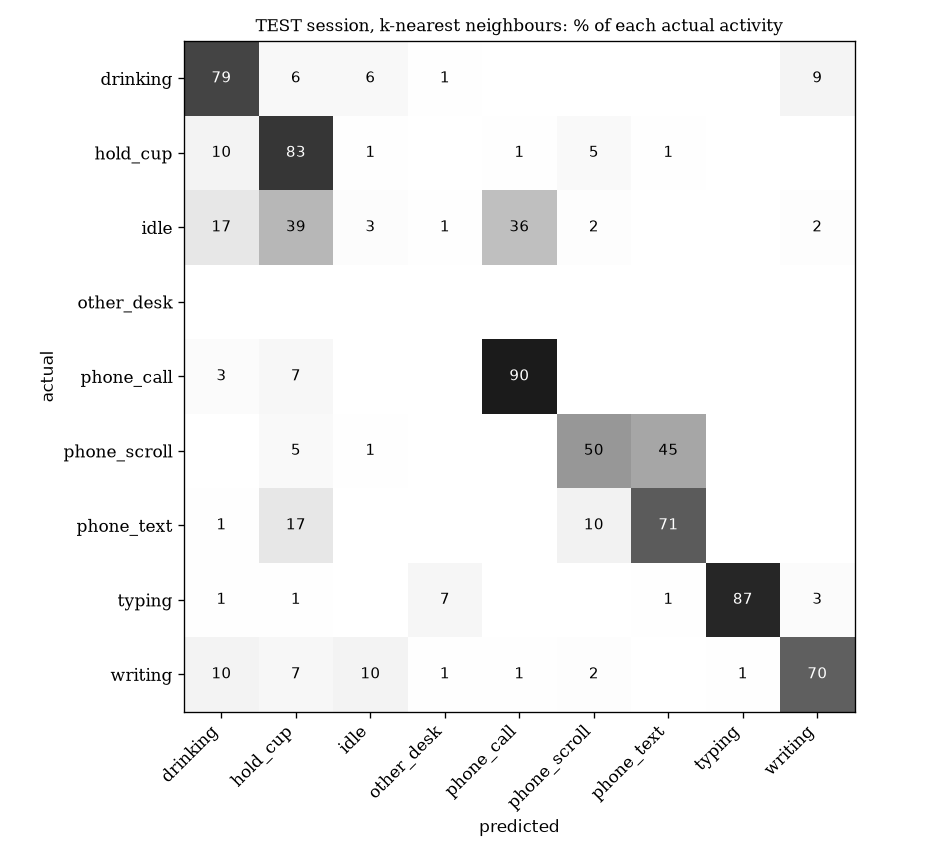
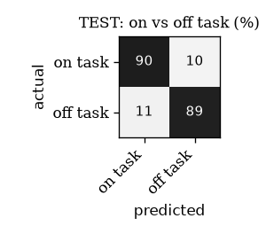
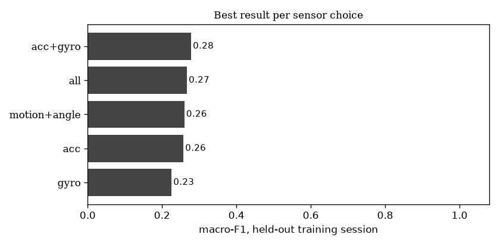
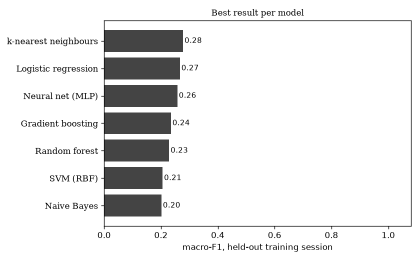

# Focus Police model report, 22 Nov 2026 08:44

Generated by `Model/train.py`. Everything below is measured on the recordings in `Data Collection/sessions/`.

**Read this first:**

- No TEST session was recorded, so the last training session (S2, LIVE_20261122-073853) was set aside as the test set.

## 1. What was chosen

- **Model:** k-nearest neighbours
- **Sensors:** acc+gyro (accX, accY, accZ, rotationRateX, rotationRateY, rotationRateZ)
- **Window:** 2 s, half-overlapping; **features:** time+frequency (110 numbers per window)
- **Live smoothing:** average of the last 1 windows (on/off accuracy when holding out one whole training session at a time: 1 → 71.4%, 3 → 69.2%, 5 → 67.9%)
- Chosen by holding out one whole training session at a time: macro-F1 0.278, accuracy 34.7%, on/off 71.4%. Score on each held-out part: [0.276, 0.281].
- 210 combinations compared; 1315 training windows; 324 s to run.

Sessions used:

| folder | session | role | labelled min | activities | shortest activity (s) |
|---|---|---|---|---|---|
| LIVE_20261112-233400 | S1 | train | 8.9 | 8 | 47 |
| LIVE_20261122-063931 | PILOT | ignored | 0.5 | 2 | 13 |
| LIVE_20261122-071736 | S1 | train | 13.7 | 8 | 53 |
| LIVE_20261122-073853 | S2 | train | 14.7 | 8 | 107 |

## 2. The final score (TEST session, never used for any choice)

| | Activity accuracy | Macro-F1 | On/off-task accuracy |
|---|---|---|---|
| **Chosen model**, each window on its own | **66.2%** | 0.566 | **89.7%** |
| Chosen model, averaged over the last 1 window(s), as on the live page | 66.2% | | 89.7% |
| Reference-paper setting: accelerometer only, simple features, Naive Bayes | 45.3% | | 90.3% |

Chance level for 9 activities is 11%. TEST has 854 windows of 2 s.

Per activity:

| activity | recall | precision | windows |
|---|---|---|---|
| drinking | 0.788 | 0.646 | 104 |
| hold_cup | 0.827 | 0.494 | 104 |
| idle | 0.027 | 0.136 | 110 |
| other_desk | nan | 0 | 0 |
| phone_call | 0.904 | 0.691 | 104 |
| phone_scroll | 0.495 | 0.722 | 105 |
| phone_text | 0.714 | 0.605 | 105 |
| typing | 0.869 | 0.989 | 107 |
| writing | 0.696 | 0.851 | 115 |

Most common mistakes (actual → predicted, windows): phone_scroll → phone_text (47); idle → hold_cup (43); idle → phone_call (40); idle → drinking (19); phone_text → hold_cup (18).

## 5. What works best (the comparison)

All numbers here come from holding out one whole training session at a time. TEST was not involved.

**By sensors** (best combination for each):

| window_s | sensors | features | model | cv_macro_f1 | cv_accuracy | cv_onoff_accuracy |
|---|---|---|---|---|---|---|
| 2 | acc+gyro | time+frequency | k-nearest neighbours | 0.278 | 0.347 | 0.714 |
| 2 | all | time+frequency | k-nearest neighbours | 0.267 | 0.337 | 0.688 |
| 4 | motion+angle | time+frequency | k-nearest neighbours | 0.26 | 0.329 | 0.71 |
| 4 | acc | time+frequency | k-nearest neighbours | 0.257 | 0.326 | 0.719 |
| 2 | gyro | time+frequency | Logistic regression | 0.226 | 0.284 | 0.671 |

**By model:**

| window_s | sensors | features | model | cv_macro_f1 | cv_accuracy | cv_onoff_accuracy |
|---|---|---|---|---|---|---|
| 2 | acc+gyro | time+frequency | k-nearest neighbours | 0.278 | 0.347 | 0.714 |
| 1 | acc+gyro | time | Logistic regression | 0.267 | 0.305 | 0.593 |
| 4 | motion+angle | time+frequency | Neural net (MLP) | 0.258 | 0.312 | 0.656 |
| 4 | acc+gyro | time+frequency | Gradient boosting | 0.235 | 0.289 | 0.726 |
| 1 | motion+angle | time+frequency | Random forest | 0.229 | 0.295 | 0.723 |
| 2 | motion+angle | time+frequency | SVM (RBF) | 0.206 | 0.258 | 0.684 |
| 2 | gyro | time+frequency | Naive Bayes | 0.202 | 0.244 | 0.585 |

**By window length:**

| window_s | sensors | features | model | cv_macro_f1 | cv_accuracy | cv_onoff_accuracy |
|---|---|---|---|---|---|---|
| 2 | acc+gyro | time+frequency | k-nearest neighbours | 0.278 | 0.347 | 0.714 |
| 4 | acc+gyro | time+frequency | k-nearest neighbours | 0.272 | 0.339 | 0.714 |
| 1 | acc+gyro | time | Logistic regression | 0.267 | 0.305 | 0.593 |

**By feature set:**

| window_s | sensors | features | model | cv_macro_f1 | cv_accuracy | cv_onoff_accuracy |
|---|---|---|---|---|---|---|
| 2 | acc+gyro | time+frequency | k-nearest neighbours | 0.278 | 0.347 | 0.714 |
| 1 | acc+gyro | time | Logistic regression | 0.267 | 0.305 | 0.593 |

**Top 15 combinations overall:**

| window_s | sensors | features | model | cv_macro_f1 | cv_accuracy | cv_onoff_accuracy |
|---|---|---|---|---|---|---|
| 2 | acc+gyro | time+frequency | k-nearest neighbours | 0.278 | 0.347 | 0.714 |
| 4 | acc+gyro | time+frequency | k-nearest neighbours | 0.272 | 0.339 | 0.714 |
| 1 | acc+gyro | time | Logistic regression | 0.267 | 0.305 | 0.593 |
| 2 | all | time+frequency | k-nearest neighbours | 0.267 | 0.337 | 0.688 |
| 4 | all | time+frequency | k-nearest neighbours | 0.26 | 0.331 | 0.691 |
| 4 | motion+angle | time+frequency | k-nearest neighbours | 0.26 | 0.329 | 0.71 |
| 4 | motion+angle | time+frequency | Neural net (MLP) | 0.258 | 0.312 | 0.656 |
| 4 | acc | time+frequency | k-nearest neighbours | 0.257 | 0.326 | 0.719 |
| 2 | motion+angle | time+frequency | k-nearest neighbours | 0.251 | 0.314 | 0.675 |
| 1 | acc+gyro | time+frequency | k-nearest neighbours | 0.249 | 0.316 | 0.679 |
| 2 | motion+angle | time+frequency | Neural net (MLP) | 0.248 | 0.303 | 0.66 |
| 2 | acc+gyro | time | Logistic regression | 0.247 | 0.291 | 0.629 |
| 1 | all | time+frequency | k-nearest neighbours | 0.246 | 0.308 | 0.682 |
| 4 | acc+gyro | time | Logistic regression | 0.246 | 0.302 | 0.652 |
| 2 | acc | time | Logistic regression | 0.244 | 0.283 | 0.586 |

## 6. How to read this

- **Macro-F1** averages the score of every activity equally, so a model can't look good by only getting the easy ones right.
- **On/off-task accuracy** is what the nudge depends on: typing mistaken for writing costs nothing there, phone mistaken for typing does.
- **Held-out session** scores are lower than a random split would give, and more honest: the model is judged on a sitting it never saw.
- 2 recorded participant IDs in training. The final evaluation uses a separate TEST session.
- Idle (reading, hands resting) counts as on task here. The reference paper counted sitting idle as distracted.

Every combination is in `all_combinations.csv` (210 rows).
