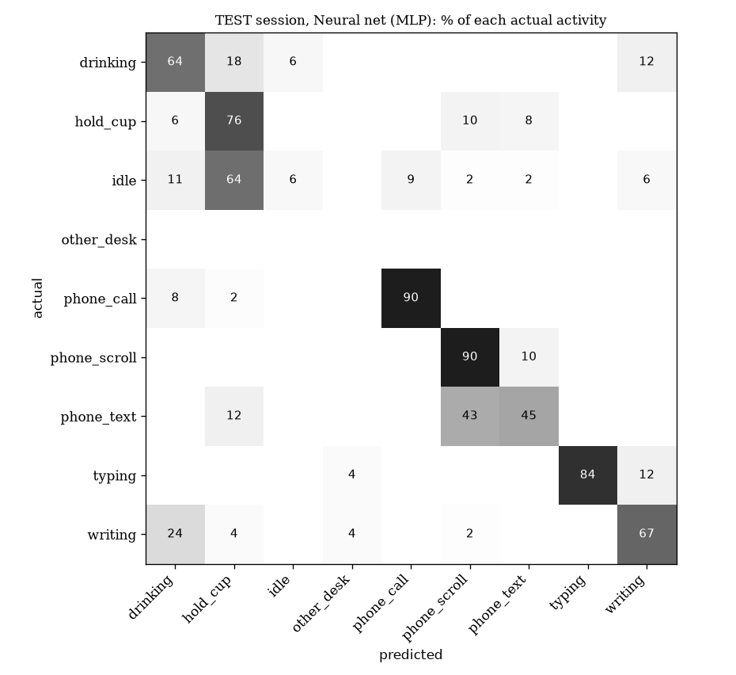
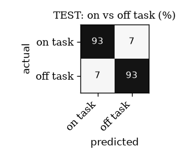
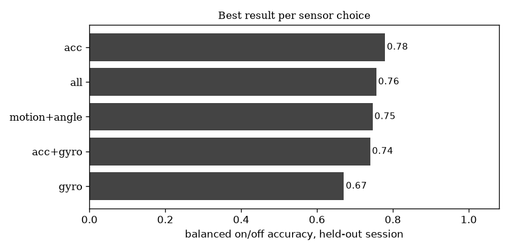
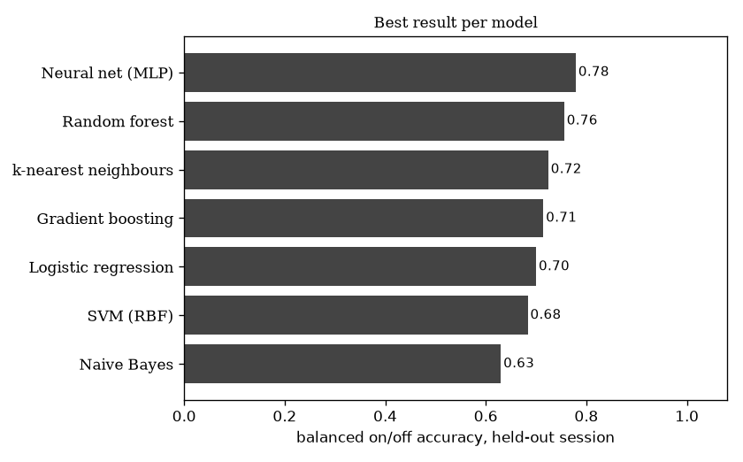

# Focus Police model report, 22 Nov 2026 08:53

Generated by `Model/train.py`. Everything below is measured on the recordings in `Data Collection/sessions/`.

**Read this first:**

- No TEST session was recorded, so the last training session (S2, LIVE_20261122-073853) was set aside as the test set.

## 1. What was chosen

- **Model:** Neural net (MLP)
- **Sensors:** acc (accX, accY, accZ)
- **Window:** 4 s, half-overlapping; **features:** time (27 numbers per window)
- **Live smoothing:** average of the last 1 windows (balanced on/off accuracy when holding out one whole training session at a time: 1 → 77.9%, 3 → 77.6%, 5 → 76.7%)
- **Selection rule:** best balanced on/off accuracy (the mean of phone caught and on-task time not flagged), then fewest false alarms, then activity macro-F1. The nudge only needs phone vs not phone, so mixing up typing and writing costs nothing here.
- Chosen by holding out one whole training session at a time: balanced on/off 77.9% (phone caught 84.4%, false alarms 28.6%), macro-F1 0.235, activity accuracy 31.7%. Balanced on/off on each held-out part: [0.805, 0.753].
- 210 combinations compared; 634 training windows; 170 s to run.

Sessions used:

| folder | session | role | labelled min | activities | shortest activity (s) |
|---|---|---|---|---|---|
| LIVE_20261112-233400 | S1 | train | 8.9 | 8 | 47 |
| LIVE_20261122-063931 | PILOT | ignored | 0.5 | 2 | 13 |
| LIVE_20261122-071736 | S1 | train | 13.7 | 8 | 53 |
| LIVE_20261122-073853 | S2 | train | 14.7 | 8 | 107 |

## 2. The final score (TEST session, never used for any choice)

| | Activity accuracy | Macro-F1 | On/off accuracy | Balanced on/off | Phone caught | False alarms | False nudges per hour | Phone blocks nudged | Median nudge delay |
|---|---|---|---|---|---|---|---|---|---|
| **Chosen model**, each window on its own | **64.9%** | 0.557 | 93.2% | **93.1%** | 92.7% | 6.6% | 0.0 | 100% | 12 s |
| Chosen model, averaged over the last 1 window(s), as on the live page | 64.9% |  | 93.2% | **93.1%** | 92.7% | 6.6% | 0.0 | 100% | 12 s |
| Reference-paper setting: accelerometer only, simple features, Naive Bayes | 45.3% |  | 90.3% | **90.4%** | 90.8% | 10.0% | 0.0 | 100% | 13 s |

Chance level for 9 activities is 11%. TEST has 410 windows of 4 s.

*Phone caught* is the share of real phone windows flagged off task; *false alarms* the share of on-task windows flagged off task. *Nudges* simulate the live page: one fires after 10 s of off task in a row. A nudge during an on-task block is false. The delay is counted from the start of the labelled phone block, which begins 3 s after the runner click.

Per activity:

| activity | recall | precision | windows |
|---|---|---|---|
| drinking | 0.64 | 0.552 | 50 |
| hold_cup | 0.76 | 0.422 | 50 |
| idle | 0.057 | 0.5 | 53 |
| other_desk | nan | 0 | 0 |
| phone_call | 0.9 | 0.9 | 50 |
| phone_scroll | 0.9 | 0.608 | 50 |
| phone_text | 0.451 | 0.697 | 51 |
| typing | 0.843 | 1 | 51 |
| writing | 0.673 | 0.712 | 55 |

Most common mistakes (actual → predicted, windows): idle → hold_cup (34); phone_text → phone_scroll (22); writing → drinking (13); drinking → hold_cup (9); typing → writing (6).

## 5. What works best (the comparison)

All numbers here come from holding out one whole training session at a time. TEST was not involved.

**By sensors** (best combination for each):

| window_s | sensors | features | model | cv_onoff_balanced | cv_false_alarm | cv_phone_caught | cv_macro_f1 | cv_accuracy |
|---|---|---|---|---|---|---|---|---|
| 4 | acc | time | Neural net (MLP) | 0.779 | 0.286 | 0.844 | 0.235 | 0.317 |
| 4 | all | time+frequency | Random forest | 0.756 | 0.244 | 0.756 | 0.198 | 0.285 |
| 4 | motion+angle | time+frequency | Random forest | 0.746 | 0.248 | 0.741 | 0.201 | 0.318 |
| 4 | acc+gyro | time+frequency | Random forest | 0.74 | 0.246 | 0.726 | 0.219 | 0.295 |
| 4 | gyro | time | k-nearest neighbours | 0.671 | 0.323 | 0.665 | 0.137 | 0.2 |

**By model:**

| window_s | sensors | features | model | cv_onoff_balanced | cv_false_alarm | cv_phone_caught | cv_macro_f1 | cv_accuracy |
|---|---|---|---|---|---|---|---|---|
| 4 | acc | time | Neural net (MLP) | 0.779 | 0.286 | 0.844 | 0.235 | 0.317 |
| 4 | all | time+frequency | Random forest | 0.756 | 0.244 | 0.756 | 0.198 | 0.285 |
| 4 | acc | time+frequency | k-nearest neighbours | 0.724 | 0.285 | 0.733 | 0.257 | 0.326 |
| 4 | acc+gyro | time+frequency | Gradient boosting | 0.715 | 0.247 | 0.676 | 0.235 | 0.289 |
| 4 | acc | time+frequency | Logistic regression | 0.7 | 0.284 | 0.684 | 0.209 | 0.289 |
| 4 | acc | time | SVM (RBF) | 0.684 | 0.212 | 0.579 | 0.173 | 0.2 |
| 2 | gyro | time | Naive Bayes | 0.63 | 0.5 | 0.761 | 0.169 | 0.201 |

**By window length:**

| window_s | sensors | features | model | cv_onoff_balanced | cv_false_alarm | cv_phone_caught | cv_macro_f1 | cv_accuracy |
|---|---|---|---|---|---|---|---|---|
| 4 | acc | time | Neural net (MLP) | 0.779 | 0.286 | 0.844 | 0.235 | 0.317 |
| 2 | all | time+frequency | Random forest | 0.734 | 0.229 | 0.697 | 0.196 | 0.265 |
| 1 | all | time | Random forest | 0.728 | 0.244 | 0.699 | 0.221 | 0.268 |

**By feature set:**

| window_s | sensors | features | model | cv_onoff_balanced | cv_false_alarm | cv_phone_caught | cv_macro_f1 | cv_accuracy |
|---|---|---|---|---|---|---|---|---|
| 4 | acc | time | Neural net (MLP) | 0.779 | 0.286 | 0.844 | 0.235 | 0.317 |
| 4 | all | time+frequency | Random forest | 0.756 | 0.244 | 0.756 | 0.198 | 0.285 |

**Top 15 combinations overall:**

| window_s | sensors | features | model | cv_onoff_balanced | cv_false_alarm | cv_phone_caught | cv_macro_f1 | cv_accuracy |
|---|---|---|---|---|---|---|---|---|
| 4 | acc | time | Neural net (MLP) | 0.779 | 0.286 | 0.844 | 0.235 | 0.317 |
| 4 | all | time+frequency | Random forest | 0.756 | 0.244 | 0.756 | 0.198 | 0.285 |
| 4 | motion+angle | time+frequency | Random forest | 0.746 | 0.248 | 0.741 | 0.201 | 0.318 |
| 4 | acc+gyro | time+frequency | Random forest | 0.74 | 0.246 | 0.726 | 0.219 | 0.295 |
| 2 | all | time+frequency | Random forest | 0.734 | 0.229 | 0.697 | 0.196 | 0.265 |
| 4 | motion+angle | time | Random forest | 0.734 | 0.242 | 0.709 | 0.214 | 0.312 |
| 2 | all | time | Random forest | 0.732 | 0.242 | 0.705 | 0.226 | 0.308 |
| 4 | all | time | Random forest | 0.732 | 0.263 | 0.726 | 0.202 | 0.305 |
| 1 | all | time | Random forest | 0.728 | 0.244 | 0.699 | 0.221 | 0.268 |
| 2 | motion+angle | time | Random forest | 0.726 | 0.25 | 0.702 | 0.222 | 0.298 |
| 2 | motion+angle | time+frequency | Random forest | 0.724 | 0.231 | 0.68 | 0.226 | 0.327 |
| 4 | acc | time+frequency | k-nearest neighbours | 0.724 | 0.285 | 0.733 | 0.257 | 0.326 |
| 1 | all | time+frequency | Random forest | 0.723 | 0.235 | 0.682 | 0.211 | 0.268 |
| 2 | acc | time+frequency | Neural net (MLP) | 0.723 | 0.261 | 0.707 | 0.224 | 0.304 |
| 4 | acc+gyro | time+frequency | k-nearest neighbours | 0.723 | 0.297 | 0.744 | 0.272 | 0.339 |

## 6. How to read this

- **Macro-F1** averages the score of every activity equally, so a model can't look good by only getting the easy ones right.
- **On/off-task accuracy** is what the nudge depends on: typing mistaken for writing costs nothing there, phone mistaken for typing does.
- **Balanced on/off accuracy** averages phone caught and on-task time correctly left alone, so a session with little phone time can't flatter a model that never flags anything. It decides the model choice.
- **False alarms** are on-task windows flagged as phone. Enough of them in a row become a false nudge, which is what makes users turn a focus tool off.
- **Held-out session** scores are lower than a random split would give, and more honest: the model is judged on a sitting it never saw.
- 2 recorded participant IDs in training. The final evaluation uses a separate TEST session.
- Idle (reading, hands resting) counts as on task here. The reference paper counted sitting idle as distracted.

Every combination is in `all_combinations.csv` (210 rows).
