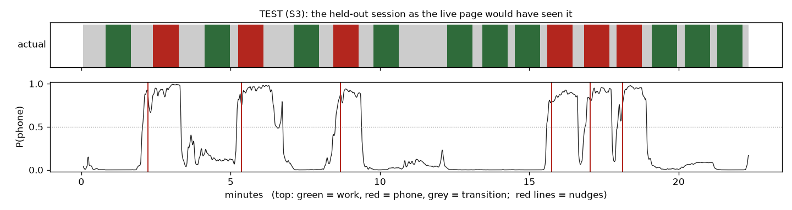
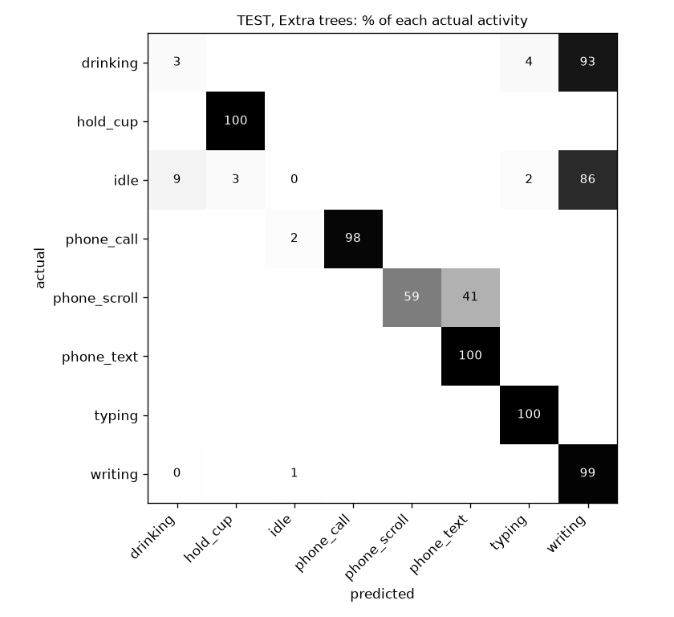

# Focus Police model report, 22 Nov 2026 17:02

Generated by `Model/train.py` (version 2). Everything below is measured on the recordings in `Data Collection/sessions/`. Why version 2 looks the way it does: `Model/lab/FINDINGS.md`.

**Read this first:**

- No TEST session was recorded, so the last training session (S3, LIVE_20261122-163642) was set aside as the test set.
- Some sessions have no recorded calibration step; their calibration pose was taken from the first 5 s of typing, which is the same pose (hands on the keyboard). See the table below.
- Training covers 2 participant(s) (P1, Suleiman). Accuracy on a new person is the open question; record more people to measure it.

## 1. What was chosen

- **Model:** Extra trees
- **Features:** motion + wrist angle + context, calibrated; 4 s window (220 numbers)
- **Live smoothing:** average of the last 5 predictions (held-out false nudges for 1 / 5 / 9: 1 / 0 / 0)
- **Selection rule:** best balanced on/off accuracy, then fewest false alarms, then activity macro-F1, all from holding out one whole training session at a time.
- Held-out score of the choice: balanced 95.3% (phone caught 94.1%, false alarms 3.4%); per held-out session [0.966, 0.923, 0.971].
- 12 candidates compared in 120 s.

Sessions:

| folder | session | participant | role | labelled min | activities | calibration |
|---|---|---|---|---|---|---|
| LIVE_20261112-233400 | S1 | P1 | train | 8.9 | 8 | first 5 s of typing (no calibration step) |
| LIVE_20261122-063931 | PILOT | P1 | ignored | 0.5 | 2 | first 5 s of typing (no calibration step) |
| LIVE_20261122-071736 | S1 | Suleiman | train | 13.7 | 8 | first 5 s of typing (no calibration step) |
| LIVE_20261122-073853 | S2 | Suleiman | train | 14.7 | 8 | first 5 s of typing (no calibration step) |
| LIVE_20261122-163642 | S3 | Sleiman | train | 14.3 | 8 | calibration step |

## 2. The final score (TEST, never used for any choice)

TEST: S3 (Sleiman, LIVE_20261122-163642). Scored on the continuous recording, every 0.5 s, as the live page runs.

| | Balanced on/off | Phone caught | False alarms | False nudges | Phone activities nudged | Median nudge delay |
|---|---|---|---|---|---|---|
| **Chosen model**, smoothed over 5 predictions as on the live page | **98.8%** | 97.5% | 0.0% | 0 (0.0/h) | 100.0% | 10 s |
| Chosen model, each prediction on its own | **99.3%** | 98.5% | 0.0% | 0 (0.0/h) | 100.0% | 8 s |
| Reference-paper setting: raw accelerometer, simple features, Naive Bayes | **94.6%** | 98.0% | 8.9% | 1 (7.1/h) | 100.0% | 8 s |

Activity names (not needed for the nudge): accuracy 69.9%, macro-F1 0.638 over 8 activities.

**What each part adds** (same model and window, retrained without the part, scored on TEST):

| | Balanced on/off | Phone caught | False alarms | False nudges | Phone activities nudged | Median nudge delay |
|---|---|---|---|---|---|---|
| motion only (version 1 features) | **99.5%** | 99.3% | 0.4% | 0 (0.0/h) | 100.0% | 8 s |
| + wrist angle + context, not calibrated | **96.0%** | 98.8% | 6.8% | 1 (7.1/h) | 100.0% | 9 s |
| + calibration (full) | **98.8%** | 97.5% | 0.0% | 0 (0.0/h) | 100.0% | 10 s |

Per activity on TEST:

| activity | flagged as phone | activity recall | windows |
|---|---|---|---|
| drinking | 0 | 0.03 | 202 |
| hold_cup | 0 | 1 | 202 |
| idle | 0 | 0.005 | 202 |
| phone_call | 0.941 | 0.975 | 203 |
| phone_scroll | 1 | 0.589 | 202 |
| phone_text | 0.985 | 1 | 203 |
| typing | 0 | 1 | 202 |
| writing | 0 | 0.985 | 203 |

*Balanced on/off* is the mean of *phone caught* (phone windows flagged) and work time left alone (1 − *false alarms*). A *nudge* fires after 10 s flagged as phone in a row; one during work is false. The delay counts from the start of the labelled phone activity, which begins 3 s after the runner click.

## 5. All candidates

Held out one whole training session at a time. TEST was not involved.

| window_s | features | model | cv_balanced | cv_false_alarm | cv_phone_caught | cv_false_nudges | cv_macro_f1 |
|---|---|---|---|---|---|---|---|
| 4 | motion + wrist angle + context, calibrated | Extra trees | 0.953 | 0.034 | 0.941 | 1 | 0.517 |
| 4 | motion + wrist angle + context, calibrated | Random forest | 0.948 | 0.04 | 0.936 | 2 | 0.515 |
| 2 | motion + wrist angle + context, calibrated | Extra trees | 0.948 | 0.041 | 0.938 | 1 | 0.494 |
| 2 | motion + wrist angle + context, calibrated | Random forest | 0.938 | 0.05 | 0.926 | 2 | 0.47 |
| 2 | motion + wrist angle + context, calibrated | Logistic regression | 0.904 | 0.098 | 0.905 | 1 | 0.532 |
| 4 | motion + wrist angle + context, calibrated | Logistic regression | 0.904 | 0.099 | 0.908 | 0 | 0.546 |
| 4 | motion only | Extra trees | 0.876 | 0.058 | 0.81 | 0 | 0.518 |
| 4 | motion only | Random forest | 0.867 | 0.039 | 0.772 | 0 | 0.495 |
| 2 | motion only | Extra trees | 0.859 | 0.076 | 0.794 | 1 | 0.506 |
| 2 | motion only | Random forest | 0.857 | 0.052 | 0.766 | 0 | 0.475 |
| 2 | motion only | Logistic regression | 0.813 | 0.085 | 0.71 | 1 | 0.465 |
| 4 | motion only | Logistic regression | 0.81 | 0.064 | 0.685 | 1 | 0.487 |

Features the model leans on most: `ctx10_pitch_mean`, `gravityY_max`, `ctx10_gy_mean`, `win_pitch_mean`, `gravityY_mean`, `gravityY_min`, `win_pitch_max`, `ctx30_pitch_min`, `ctx30_roll_c_std`, `ctx10_gx_mean`, `ctx30_pitch_max`, `ctx10_face_mean`.

## 6. How to read this

- **Balanced on/off accuracy** averages phone caught and work left alone, so a model that never flags anything can't look good. It decides the choice.
- **False alarms** are work moments flagged as phone; ten seconds of them in a row make a false nudge, which is what makes people switch a focus tool off.
- **Held-out sessions** are the honest test: the model is judged on a sitting it never saw.
- Idle (reading, hands resting) counts as on task here. The reference paper counted sitting idle as distracted.

