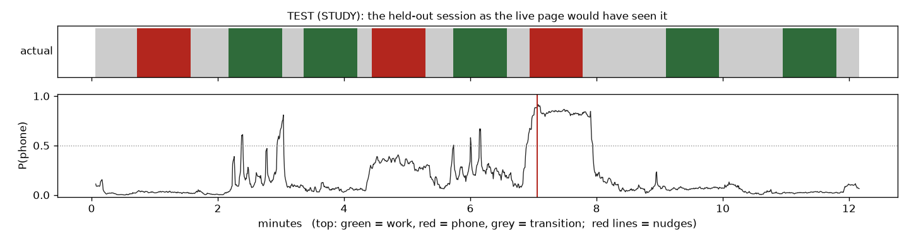
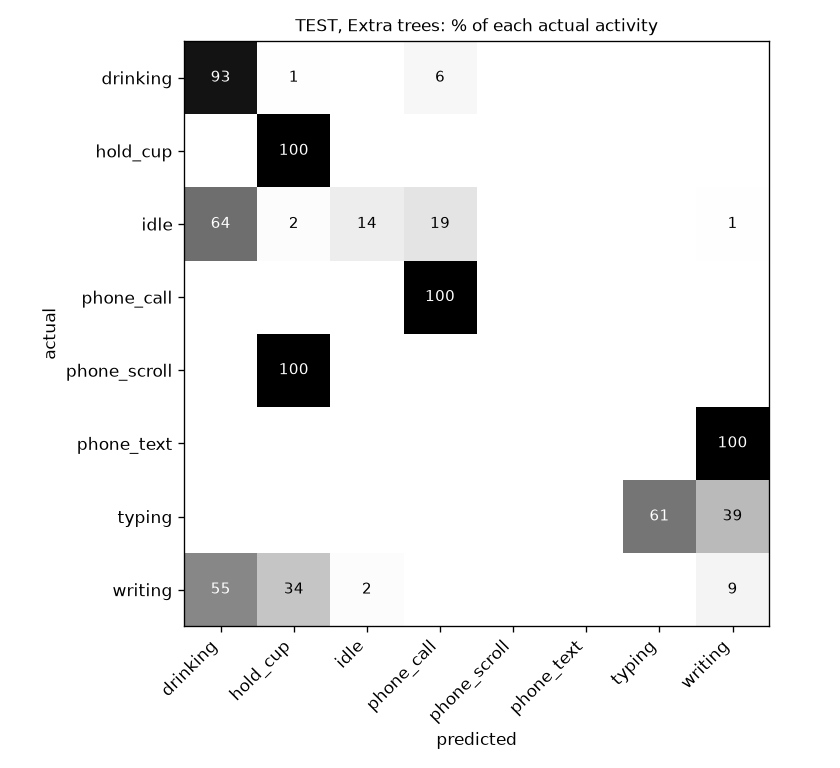

# Focus Police model report, 22 Nov 2026 21:38

Generated by `Model/train.py` (version 2). Everything below is measured on the recordings in `Data Collection/sessions/`. Why version 2 looks the way it does: `Model/lab/FINDINGS.md`.

**Read this first:**

- Test set: every session of participant(s) P-MQME, set aside before any choice. The model never saw these people.
- Some sessions have no recorded calibration step; their calibration pose was taken from the first 5 s of typing, which is the same pose (hands on the keyboard). See the table below.
- Training covers 2 participant(s) (P-8BZH, P1). Accuracy on a new person is the open question; record more people to measure it.

## 1. What was chosen

- **Model:** Extra trees
- **Features:** motion + wrist angle + context, calibrated; 4 s window (220 numbers)
- **Live smoothing:** average of the last 1 predictions (held-out false nudges for 1 / 5 / 9: 0 / 0 / 0)
- **Selection rule:** best balanced on/off accuracy, then fewest false alarms, then activity macro-F1, all from holding out one whole training session at a time.
- Held-out score of the choice: balanced 97.2% (phone caught 96.8%, false alarms 2.4%); per held-out session [0.978, 0.951, 0.968, 0.99].
- 12 candidates compared in 46 s.

Sessions:

| folder | session | participant | role | labelled min | activities | calibration |
|---|---|---|---|---|---|---|
| LIVE_20261112-233400 | S1 | P1 | train | 8.9 | 8 | first 5 s of typing (no calibration step) |
| LIVE_20261122-063931 | PILOT | P1 | ignored | 0.5 | 2 | first 5 s of typing (no calibration step) |
| LIVE_20261122-071736 | S1 | P-8BZH | train | 13.7 | 8 | first 5 s of typing (no calibration step) |
| LIVE_20261122-073853 | S2 | P-8BZH | train | 14.7 | 8 | first 5 s of typing (no calibration step) |
| LIVE_20261122-192937 | STUDY | P-MQME | train | 7.2 | 8 | calibration step |
| LIVE_20261122-210317 | STUDY | P1 | train | 7.2 | 8 | calibration step |

## 2. The final score (TEST, never used for any choice)

TEST: STUDY (P-MQME, LIVE_20261122-192937). Scored on the continuous recording, every 0.5 s, as the live page runs.

| | Balanced on/off | Phone caught | False alarms | False nudges | Phone activities nudged | Median nudge delay |
|---|---|---|---|---|---|---|
| **Chosen model**, smoothed over 1 predictions as on the live page | **64.9%** | 33.3% | 3.6% | 0 (0.0/h) | 33.3% | 7 s |
| Chosen model, each prediction on its own | **64.9%** | 33.3% | 3.6% | 0 (0.0/h) | 33.3% | 7 s |
| Reference-paper setting: raw accelerometer, simple features, Naive Bayes | **63.5%** | 33.3% | 6.3% | 0 (0.0/h) | 33.3% | 7 s |

Activity names (not needed for the nudge): accuracy 47.2%, macro-F1 0.394 over 8 activities.

**What each part adds** (same model and window, retrained without the part, scored on TEST):

| | Balanced on/off | Phone caught | False alarms | False nudges | Phone activities nudged | Median nudge delay |
|---|---|---|---|---|---|---|
| motion only (version 1 features) | **66.5%** | 38.3% | 5.3% | 0 (0.0/h) | 66.7% | 10 s |
| + wrist angle + context, not calibrated | **60.7%** | 33.3% | 11.9% | 0 (0.0/h) | 33.3% | 7 s |
| + calibration (full) | **64.9%** | 33.3% | 3.6% | 0 (0.0/h) | 33.3% | 7 s |

Per activity on TEST:

| activity | flagged as phone | activity recall | windows |
|---|---|---|---|
| drinking | 0.059 | 0.931 | 101 |
| hold_cup | 0 | 1 | 101 |
| idle | 0.119 | 0.139 | 101 |
| phone_call | 1 | 1 | 101 |
| phone_scroll | 0 | 0 | 101 |
| phone_text | 0 | 0 | 101 |
| typing | 0 | 0.614 | 101 |
| writing | 0 | 0.089 | 101 |

*Balanced on/off* is the mean of *phone caught* (phone windows flagged) and work time left alone (1 − *false alarms*). A *nudge* fires after 10 s flagged as phone in a row; one during work is false. The delay counts from the start of the labelled phone activity, which begins 3 s after the runner click.

## 4. Each held-out session, chosen model

Held out one whole training session at a time.

| held-out session | participant | balanced on/off |
|---|---|---|
| S1 (LIVE_20261112-233400) | P1 | 97.8% |
| S1 (LIVE_20261122-071736) | P-8BZH | 95.1% |
| S2 (LIVE_20261122-073853) | P-8BZH | 96.8% |
| STUDY (LIVE_20261122-210317) | P1 | 99.0% |

## 5. All candidates

Held out one whole training session at a time. TEST was not involved.

| window_s | features | model | cv_balanced | cv_false_alarm | cv_phone_caught | cv_false_nudges | cv_macro_f1 |
|---|---|---|---|---|---|---|---|
| 4 | motion + wrist angle + context, calibrated | Extra trees | 0.972 | 0.024 | 0.968 | 0 | 0.578 |
| 4 | motion + wrist angle + context, calibrated | Random forest | 0.97 | 0.021 | 0.96 | 1 | 0.581 |
| 2 | motion + wrist angle + context, calibrated | Extra trees | 0.966 | 0.031 | 0.963 | 1 | 0.579 |
| 2 | motion + wrist angle + context, calibrated | Random forest | 0.965 | 0.028 | 0.959 | 0 | 0.553 |
| 4 | motion only | Random forest | 0.943 | 0.03 | 0.915 | 0 | 0.565 |
| 2 | motion only | Extra trees | 0.942 | 0.053 | 0.937 | 1 | 0.549 |
| 2 | motion only | Random forest | 0.941 | 0.039 | 0.921 | 0 | 0.556 |
| 4 | motion only | Extra trees | 0.94 | 0.045 | 0.925 | 2 | 0.567 |
| 4 | motion + wrist angle + context, calibrated | Logistic regression | 0.939 | 0.067 | 0.945 | 1 | 0.592 |
| 2 | motion + wrist angle + context, calibrated | Logistic regression | 0.928 | 0.082 | 0.938 | 1 | 0.579 |
| 4 | motion only | Logistic regression | 0.925 | 0.054 | 0.904 | 0 | 0.546 |
| 2 | motion only | Logistic regression | 0.92 | 0.08 | 0.92 | 0 | 0.523 |

Features the model leans on most: `win_pitch_mean`, `ctx10_pitch_mean`, `ctx10_gy_mean`, `gravityY_min`, `gravityY_mean`, `gravityX_mean`, `ctx10_gx_mean`, `ctx30_roll_c_std`, `gravityY_max`, `ctx30_pitch_max`, `ctx30_pitch_min`, `win_pitch_max`.

## 6. How to read this

- **Balanced on/off accuracy** averages phone caught and work left alone, so a model that never flags anything can't look good. It decides the choice.
- **False alarms** are work moments flagged as phone; ten seconds of them in a row make a false nudge, which is what makes people switch a focus tool off.
- **Held-out sessions** are the honest test: the model is judged on a sitting it never saw.
- Idle (reading, hands resting) counts as on task here. The reference paper counted sitting idle as distracted.

